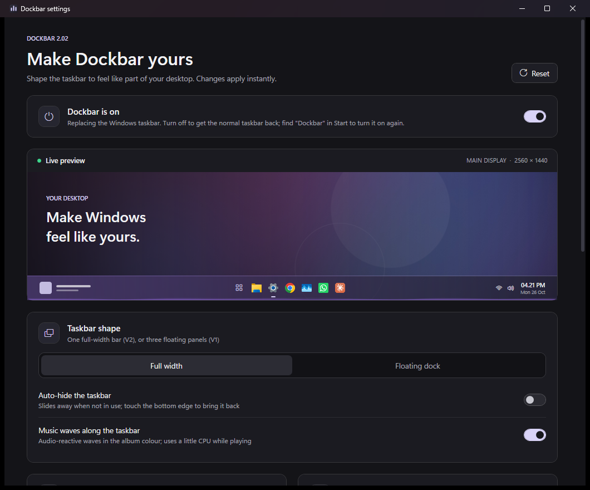
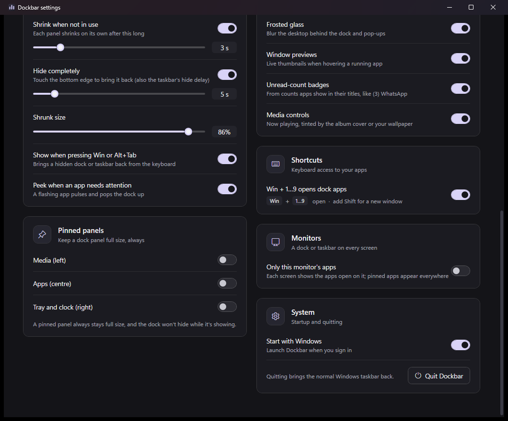

# Dockbar

A replacement for the Windows 11 taskbar. It hides the stock taskbar and draws its own, in either of
two looks you can switch between at any time:

**[⬇ Download the latest release](https://github.com/Raunak-kushwaha/dockbar-release/releases/latest)**: an installer, or a single exe; nothing else to install.

| | **Full width** | **Floating dock** (default) |
|---|---|---|
| Shape | One edge-to-edge frosted bar, apps centred | Three floating panels: media, apps, tray |
| Space | Reserves the bottom of the screen like the real taskbar, or auto-hides | Floats over windows. Each panel shrinks when idle, and the whole dock can slide away |
| Media | The whole bar is tinted by the album art, with audio-reactive waves along it | The left panel is a player with waves and a seekable timeline |

## Features

**Apps**
- Pinned and running apps in one list, grouped by app (Store apps included), with running and active indicators.
- Live window thumbnails on hover, with a list when an app has several windows.
- Drag to reorder pins, drag a running app in to pin it, and drop files on an app to open them with it.
- Unread-count badges, such as WhatsApp's.
- An app that wants attention pulses, and brings a hidden bar back into view.
- `Win + 1…9` opens or switches to the app in that position, and `Win + Shift + number` opens a new window.
- Right-click an app for its **jump list**, as on the Windows taskbar: its tasks (Chrome's "New Incognito window", WhatsApp's recent chats) and recent files. Below that: switch between its windows, close them, or **End task** when it's stuck.

**Media**
- Shows what's playing in Spotify, browsers and other apps, with play/pause, skip and a seekable timeline.
- Takes its colour from the album art, or from your wallpaper when there's none.
- Hover the player to scroll a long title. Double-click the album art to open the app that's playing.
- Scroll over the player to change that app's volume; middle-click mutes it. Its tooltip names the app and its level, e.g. "Spotify: 35%".
- Collapses to a single arrow for privacy while screen-sharing.

**Tray and clock**
- Your tray icons, tucked behind an arrow that opens sideways within the bar.
- Network, volume and a Mac-style battery icon, with tooltips like Windows': your Wi-Fi's name and
  internet status, the output and level ("Speakers (USB): 20%"), and the battery's time left or charging state.
- Scroll over the volume icon to change the volume.
- The clock shows your unread notification count, and a moon while Do Not Disturb is on. Clicking it
  opens a calendar with a way on to Windows' notifications.
- Show desktop in the far corner (full-width style), as on the stock taskbar.

**Everywhere**
- Real frosted glass behind the bar and its pop-ups.
- A bar or dock on every monitor. You can limit each monitor to the apps open on it.
- Steps aside for Start, Search and the side panels. Press `Win` or `Alt+Tab` to bring a hidden bar back.
- **Light and dark**, following Windows, or pinned in settings.
- **Keyboard and screen readers.** `Win + T` puts the keyboard on the bar's apps and `Win + B` on its
  tray. Arrows move, Enter opens, the menu key opens the right-click menu, Esc goes back.
- **Update check.** Dockbar tells you in its settings when a newer release is out.

## Install

Requires Windows 11, 64-bit. Windows 10 (2004 or later) should work but is untested.

**Installer (recommended):** download `Dockbar-Setup-v….exe` from the
[latest release](https://github.com/Raunak-kushwaha/dockbar-release/releases/latest) and run it.
- It installs for your account only, with no admin prompt.
- It adds Dockbar to Start and to Windows' installed apps, and can start it when you sign in.
- Running a newer installer updates Dockbar in place.
- Uninstalling gives the Windows taskbar back. Your settings are kept.

**Or the zip:** extract `Dockbar.exe` somewhere permanent, for example `%LOCALAPPDATA%\Programs\Dockbar`,
and run it.
- **To update:**
  1. Right-click Start → **Turn off Dockbar**.
  2. Replace the exe with the new one.
  3. Start it again.

Windows SmartScreen may warn about an unrecognised app, because Dockbar isn't code-signed. Choose
**More info → Run anyway**.

For the frosted look, turn on **Transparency effects** in Windows (Settings → Personalization → Colors).

## Settings

Right-click the Start button on the bar and choose **Dockbar settings…**, or start Dockbar again from
the Start menu. Every change applies immediately, and a live preview shows your wallpaper, your apps
and your style.

| Section | What it controls |
|---|---|
| *(top of the page)* | **Dockbar is on / off** |
| Style | Full width or Floating dock; taskbar auto-hide; music waves along the taskbar |
| Dock auto-hide | Shrink delay, hide delay and shrunk size; reveal with the keyboard or on app attention |
| Pinned panels | Keep the media, apps or tray panel of the dock full size and visible |
| Look and feel | Appearance (follow Windows, light, dark), frosted glass, window previews, badges, media controls |
| Shortcuts | `Win + number` shortcuts |
| Monitors | Show only each monitor's own apps on its bar |
| System | Start with Windows; check for updates |

## Turning Dockbar off and on

- **Turn it off** with the switch at the top of settings, or right-click Start → **Turn off Dockbar**.
  The Windows taskbar comes back exactly as it was, and Dockbar stays off until you turn it back on.
- **Turn it back on:** search for **Dockbar** in the Start menu, open it, and flip the switch.
- **Emergency:** run `Dockbar.exe --restore`. It quits Dockbar and brings the Windows taskbar back.
- If Dockbar ever crashes, it restarts itself. If it keeps crashing, the Windows taskbar comes back.

## Versions

- **v2.021**: jump lists, network and battery tooltips, a calendar, light mode, keyboard and
  screen-reader access, an update check, and an installer. Album art from browser players fixed.
- **v2.02**: volume levels in tooltips with the output device and the playing app; half the startup CPU.
- **v2.01**: reliability fixes, an on/off switch, End task, missing tray icons fixed, new media buttons.

Release notes for each version are on the [releases page](https://github.com/Raunak-kushwaha/dockbar-release/releases).

## Issues and license

Found a bug or have an idea? [Open an issue](https://github.com/Raunak-kushwaha/dockbar-release/issues).

Dockbar is free to download and use, but it isn't open source: the code and design are the property of
Raunak Kushwaha, and copying, modifying or redistributing them isn't permitted. See [LICENSE](LICENSE).
